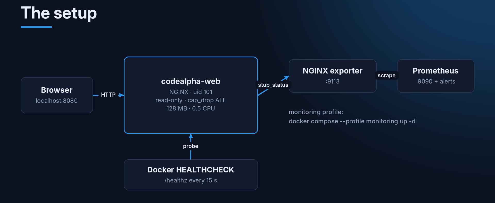
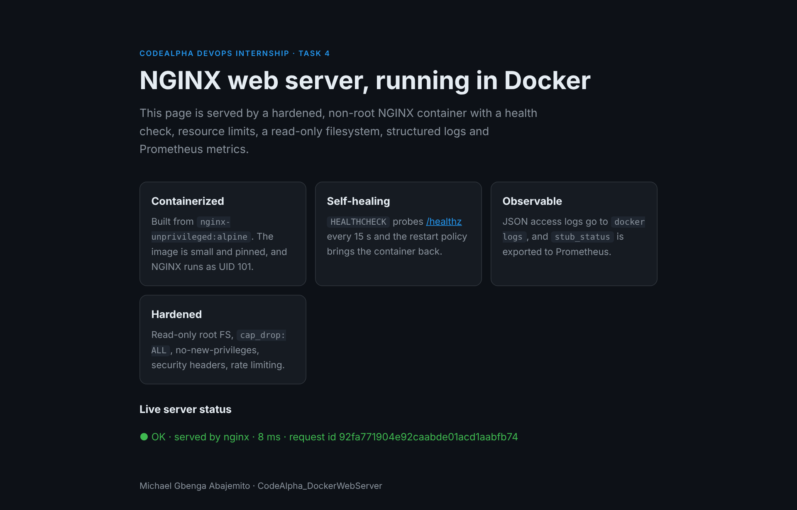
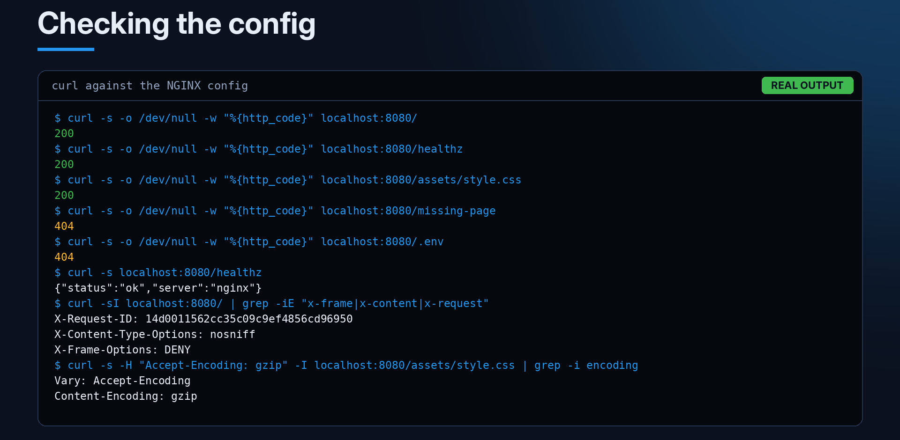
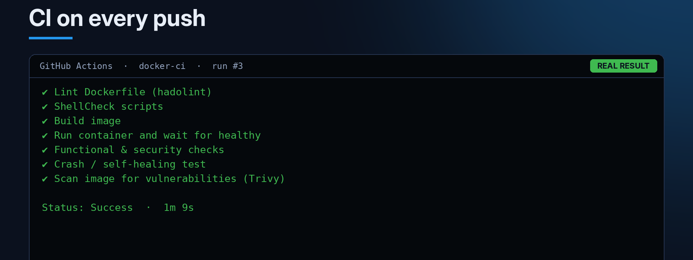

Second project from my CodeAlpha DevOps internship. The task was to deploy and manage a web server inside Docker, learn the container lifecycle, and monitor the container's health.

Getting NGINX running in Docker is one command. So I tried to set it up the way you'd want it in production: not running as root, locked down, with a proper health check, and able to recover on its own if it crashes.

**Repo:** [github.com/mikegbenga/CodeAlpha_DockerWebServer](https://github.com/mikegbenga/CodeAlpha_DockerWebServer)

## What I built



- An NGINX container based on `nginx-unprivileged`, running as user 101
- A `/healthz` endpoint that Docker checks every 15 seconds
- A read-only filesystem, no Linux capabilities, and CPU and memory limits
- `manage.sh`, a script for the whole container lifecycle, with tests and a crash test
- Optional monitoring with the NGINX Prometheus exporter and Prometheus
- GitHub Actions that lint, build, run, test and scan the image on every push

This is the page it serves. The status line at the bottom calls `/healthz` from the browser and shows the request ID that NGINX adds to every response.



## The Dockerfile

```dockerfile
FROM nginxinc/nginx-unprivileged:1.27-alpine

USER 0
RUN rm -f /etc/nginx/conf.d/default.conf
COPY --chown=nginx:nginx nginx/nginx.conf      /etc/nginx/nginx.conf
COPY --chown=nginx:nginx nginx/conf.d/         /etc/nginx/conf.d/
COPY --chown=nginx:nginx site/                 /usr/share/nginx/html/
RUN nginx -t
USER 101

EXPOSE 8080
STOPSIGNAL SIGQUIT

HEALTHCHECK --interval=15s --timeout=3s --start-period=5s --retries=3 \
  CMD ["wget", "-q", "--spider", "http://127.0.0.1:8080/healthz"]

CMD ["nginx", "-g", "daemon off;"]
```

What each part is for:

- **`nginx-unprivileged`** listens on 8080 and runs as a normal user. A non-root user can't bind to ports below 1024, which is why it's 8080 and not 80.
- **`RUN nginx -t`** checks the config during the build. A typo fails the build instead of the deploy. This saved me more than once.
- **`STOPSIGNAL SIGQUIT`** makes `docker stop` shut NGINX down gracefully, so requests in progress get to finish.
- **`HEALTHCHECK`** is what makes `docker ps` show `(healthy)` or `(unhealthy)` instead of just "Up".

## Running it safely (docker-compose.yml)

```yaml
services:
  web:
    build: .
    image: codealpha/webserver:latest
    ports:
      - "8080:8080"
    restart: unless-stopped
    healthcheck:
      test: ["CMD", "wget", "-q", "--spider", "http://127.0.0.1:8080/healthz"]
      interval: 15s
      timeout: 3s
      retries: 3
    read_only: true
    tmpfs:
      - /tmp:size=16m
    cap_drop: [ALL]
    security_opt:
      - no-new-privileges:true
    deploy:
      resources:
        limits:
          cpus: "0.50"
          memory: 128M
    logging:
      driver: json-file
      options:
        max-size: "10m"
        max-file: "3"
```

- `read_only: true`: nothing in the container can be changed, even if someone gets in.
- `tmpfs: /tmp`: NGINX still needs somewhere to write temp files, so I pointed all its temp paths at `/tmp` in `nginx.conf`.
- `cap_drop: [ALL]` and `no-new-privileges`: the process gets no special Linux permissions and can't gain any.
- `deploy.resources.limits`: one container can't eat the whole server.
- Log rotation, so `docker logs` can't fill the disk.

## The NGINX config

Main settings in `nginx.conf`:

```nginx
pid /tmp/nginx.pid;
client_body_temp_path /tmp/client_temp;
proxy_temp_path       /tmp/proxy_temp;

log_format json escape=json '{"time":"$time_iso8601","request_id":"$request_id",'
                            '"method":"$request_method","uri":"$request_uri",'
                            '"status":$status,"request_time":$request_time}';
access_log /dev/stdout json if=$loggable;   # health checks are not logged

server_tokens off;
gzip on;
limit_req_zone $binary_remote_addr zone=perip:10m rate=20r/s;
```

And the server block in `conf.d/site.conf`:

```nginx
add_header X-Content-Type-Options "nosniff" always;
add_header X-Frame-Options        "DENY" always;
add_header X-Request-ID           $request_id always;

location = /healthz {
    access_log off;
    default_type application/json;
    return 200 '{"status":"ok","server":"nginx"}';
}

location = /nginx_status {
    stub_status;
    allow 10.0.0.0/8;
    allow 172.16.0.0/12;
    allow 192.168.0.0/16;
    deny  all;
}

location ~ /\. { deny all; return 404; }   # .git, .env and other hidden files
```

There's also a custom 404 page:


One thing that tripped me up: I originally had `listen [::]:8080;` as well. On a machine with IPv6 turned off, NGINX refused to start with `Address family not supported by protocol`. I removed that line.

Another one: in NGINX, if a `location` block has its own `add_header`, it **replaces** the headers from the server block instead of adding to them. So the security headers have to be repeated in those locations.

## Checking it works

I ran the config on a real NGINX and checked it with curl:



## The lifecycle script

`scripts/manage.sh` wraps the Docker commands so the whole lifecycle is one script:

```bash
./scripts/manage.sh build       # build the image
./scripts/manage.sh run         # docker run with all the hardening flags, then wait until healthy
./scripts/manage.sh status      # status, restart count, OOMKilled, exit code
./scripts/manage.sh health      # health state + last 5 probe results
./scripts/manage.sh logs        # follow logs
./scripts/manage.sh stats       # CPU and memory against the limits
./scripts/manage.sh stop        # graceful stop
./scripts/manage.sh test        # 8 functional + security checks
./scripts/manage.sh crash-test  # kill the server and check it comes back
./scripts/manage.sh clean       # remove container and image
```

The `test` command checks the pages, the health endpoint, the 404 page, that `.env` is blocked, the security headers, that the root filesystem is read-only, and that it's not running as root.

### The crash test

This was the most interesting part for me. My first idea was `docker exec … kill -9 1`. It didn't work, because PID 1 inside a container ignores `SIGKILL` sent from inside its own namespace. Asking NGINX itself to stop works:

```bash
docker exec codealpha-web nginx -s stop
```

The container exits, the `unless-stopped` restart policy starts it again, and the restart count goes up. Then the script waits until it's healthy again.

One more thing worth knowing: Docker on its own **does not restart a container just because it's unhealthy**. It only restarts containers that exit. That's why there's also `scripts/health-monitor.sh`, which restarts the container after 3 failed checks in a row. Swarm or Kubernetes would do this for you.

## Container lifecycle cheat sheet

| Stage | Command | What happens |
|---|---|---|
| Build | `docker build -t codealpha/webserver .` | Layers are cached; `nginx -t` runs |
| Run | `docker run -d --name codealpha-web -p 8080:8080 …` | Created and started |
| Health | `docker inspect -f '{{.State.Health.Status}}' codealpha-web` | `starting` → `healthy` / `unhealthy` |
| Pause | `docker pause` / `docker unpause` | Processes frozen, port still bound |
| Stop | `docker stop -t 10 codealpha-web` | `SIGQUIT`, then `SIGKILL` after 10 s |
| Restart | `docker restart codealpha-web` | Stop + start |
| Remove | `docker rm -f codealpha-web` | Container gone; the image stays |

## Monitoring

```bash
docker compose --profile monitoring up -d --build
```

This also starts the `nginx-prometheus-exporter`, which reads `/nginx_status`, and Prometheus on port 9090. Prometheus has two alert rules: `NginxDown` and too many active connections.

## CI with GitHub Actions

Every push runs `.github/workflows/docker-ci.yml`:



To be honest, the first two runs failed:

1. I'd pinned `aquasecurity/trivy-action@0.28.0`, which doesn't exist. The releases use a `v` prefix, so `v0.36.0` works.
2. ShellCheck complained about `A && B || C` (SC2015), because if B fails, C runs even though A succeeded. I changed those lines to proper `if/else`.

Third run passed in 1 minute 9 seconds.

## Troubleshooting

| Problem | Likely cause | Fix |
|---|---|---|
| `port is already allocated` | Something else is on 8080 | `HOST_PORT=8081 ./scripts/manage.sh run` |
| `Read-only file system` error | A temp path isn't on the tmpfs | Keep the `*_temp_path /tmp/...` lines |
| `bind() to 0.0.0.0:80 failed (13: Permission denied)` | Non-root can't use port 80 | Listen on 8080, map `-p 80:8080` |
| Stuck on `starting` | The probe can't reach `/healthz` | `docker exec codealpha-web wget -qO- http://127.0.0.1:8080/healthz` |
| `OOMKilled: true` | Hit the memory limit | Raise the limit |

## What I learned

- A health check tells you a lot more than "the container is running".
- Most of the hardening is just a few lines of config.
- Checking the config during the build catches mistakes early.
- You don't really know self-healing works until you crash it on purpose.

Next in the series: Jenkins Remoting, running builds on other machines.

Thanks to [CodeAlpha](https://www.codealpha.tech) for the internship.
